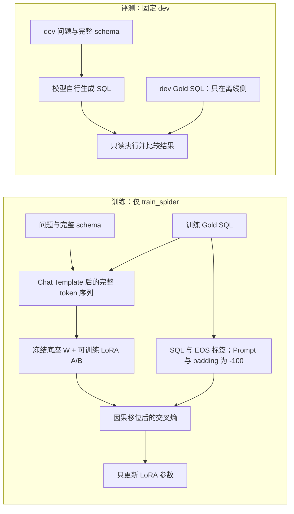

# 学习指南：当前 E0 准备

目标是量清楚“未经本任务微调的小模型能做到什么”，不是用10道题挑出漂亮分数。数据流是 db_id→完整schema，question+schema→固定chat messages→tokenizer→模型输出→最小清洗→只读SQL执行→官方结果比较。Gold只存在评分侧。

关键入口：src/data/prompt.py、schema.py、scripts/prepare_e0.py、run_e0.py、evaluate_predictions.py。配置configs/e0.json。模型和评分源码有固定revision与散列，推理逐例写盘并校验恢复配置。

参数：BF16减少权重显存但不是4-bit量化；batch=1降低峰值；greedy不采样；输出256 token是统一预算，达到上限要标注，不能补答案。输入上限2048，当前dev最高792。

典型工程失败：原schema过滤漏掉sqlite_sequence；标准查询超过旧行数上限；库里有非UTF8文本。它们说明数据/执行问题必须先于模型能力归因。

当前无模型精度，1034条gold可执行不代表模型准确率100%。EX依据查询结果判定，可能出现不同SQL碰巧返回相同结果；TSA需要多个测试数据库。可执行率只排除语法/运行错误，不保证答案正确。

面试自测：

1. 为什么不能把gold用于schema选表？
2. Chat template与自己拼接字符串有什么区别？
3. BF16与QLoRA分别改变什么？
4. greedy为什么仍需记录软硬件版本？
5. SQLite busy_timeout为什么不是查询超时？
6. 结果比较为什么要保留重复行和ORDER BY？
7. 单库EX为什么不能证明所有数据库内容下都等价？
8. dev参与方法选择后为什么不能称独立测试集？

最小亲自运行：在text2sql环境运行 `python -m unittest discover -s tests -v`，阅读 docs/tokenizer_example.md，解释每一段输入的来源。

面试表述：我先固定数据、schema、prompt和计分协议，建立无任务微调对照；用逐样本记录保证每个数字可追溯，再研究SFT与采样改进。E0/E1/E3 已完成全量 dev 对照，实测结果和限制见下文。


## E1：理解监督微调（训练和全量dev评测均已完成）

目标：让已有代码模型适应 Spider 的问题表达、schema 和 SQL 风格。LoRA 冻结大部分模型，把可训练低秩矩阵放在七类线性层上；它降低优化器/梯度开销，不保证 SQL 正确，也没有消除基座权重和激活的显存占用。

数据流：train_spider.json → 完整 schema → 相同 system/user 消息 → assistant Gold SQL → tokenizer → labels。Prompt 对理解答案有用，仍参加前向传播；label=-100 只表示不对这些位置计算目标损失。SQL token 和结束标记被监督。Padding 的 attention_mask=0，labels=-100；真正 EOS 的 label 不能因为 pad_token_id 同值而误屏蔽。

入口为 src/train/data.py、scripts/prepare_sft.py、scripts/train_lora.py。固定参数见 configs/e1.json。7000条、最长2226、训练上限2304，保留全部样本。有效 batch 通常16（1×16），最后8条；不是把16条同时放进显存。r=8控制可训练低秩容量，alpha=16控制缩放；两者不能混同。bf16底座不代表优化器状态也都使用bf16。

因果预测位置 t-1 预测 token t。我们只把需要预测 SQL 的 hidden states 投影到词表，避免为 Prompt 计算巨大 logits；decoder 仍看完整上下文。小 Qwen 单测将它与常规全 logits + masked CE 的 loss/梯度比较。最长训练样本还会实际做 GPU 前后向预检查，清梯度、恢复随机状态再开始训练。

结果解读：loss 下降表示训练答案预测更容易，不等于未见数据库上 EX 提升。只看预算结束的 adapter，不能依据 dev 不断挑选最佳 checkpoint。E3 已采用固定样本顺序的复杂度loss加权，保持相同曝光和token总量。若改用加权采样，会产生重复且token总量可能不同。无论采用何种方法，都必须单列唯一样本数/曝光数/总token/监督token。

常见失败：错误 label mask 会让模型主要学习长 Prompt；截断可能只留下 Prompt 没有答案；schema linking 失败会输出存在但不对应问题的列；微调后 EX 降低也可能是过拟合或底座已有能力受到干扰。

面试自测：

1. 冻结底座后为什么仍需要计算大部分反向传播？
2. LoRA 的 A/B 矩阵如何影响原线性层？r 和 alpha 有什么区别？
3. 为什么 Prompt label=-100，但 Prompt 的 attention_mask 不应是0？
4. 何时 EOS 也可能被错误屏蔽？
5. gradient accumulation 与真正 batch=16 完全一样吗（dropout/数值/最后批次）？
6. gradient checkpointing 用什么代价换显存？
7. SQL-only loss 与 EX 衡量的是同一件事吗？
8. E3 重采样时训练曝光数相同，为什么 token预算仍不一定相同？
9. 单次seed有什么结论限制？

最小示例：使用 text2sql Python 运行 `-m unittest discover -s tests -p test_sft.py -v`，先读 test_answer_boundary。面试解释：我用标准 PEFT LoRA 做控制组，自己完成数据边界、SQL-only监督、资源测量和一致评测；不是声称提出了 LoRA。


## E0 结果的三个层次

1034条中，525条结果匹配；204条SQL能够执行但答案不匹配；305条无法在受限SQLite环境成功执行。先区分语法/字段可执行性与语义正确性，再解释准确率。真实例子见 docs/e0_case_walkthrough.md：多余INNER JOIN会排除本来应该保留的歌手，因此可执行不等于正确。

本次 extra-hard EX 40.96% 略高于 hard 的37.36%，并不意味着官方标签错了。官方难度按SQL结构划分，不是对这个具体模型的难易预测；各桶的数据库、问题风格与样本数量不同，也有统计波动。不能要求模型准确率必然按标签单调下降，更不能为了呈现单调而改标签。

训练日志的loss使用teacher forcing：预测下一SQL token时会看到正确的前缀；正式推理则看到自己先前生成的token，错误可能累积。因此E1早期loss较低与E0有大量自由生成错误并不矛盾。


## 用一张数据流图区分训练与评测



训练时完整序列包含训练SQL，因果注意力只看当前位置之前的token，模型在teacher forcing下预测下一个token；这不是把dev答案放进推理Prompt。评测时Gold只进入比较器。

LoRA线性层可以写为 `y = W x + (alpha/r) B A x`。W固定；A形状为 r×d_in，B为 d_out×r，每层新增参数 r(d_in+d_out)。本项目r=8、alpha=16，分支缩放为2。PEFT默认初始化下B为零，因此初始增量为零；训练逐步改变低秩增量。LoRA不是压缩已有W，所以BF16底座仍占约3GB；量化底座属于另一条QLoRA路线，不能混称。

“未见数据库”只指项目SFT的train/dev数据库不重叠。我们无法审计Qwen全部预训练语料，因此不声称Spider从未出现在底座预训练中；zero-shot在这里指本项目未做SFT、推理没有few-shot例子。所有对照共享同一底座，结果仍应限于这个固定benchmark协议。

## E1 已核实的训练成本与恢复证据

7000 条、438 步已完成，训练循环 2941.031 秒，峰值 allocated 4.516 GB、reserved 7.539 GB。allocated 是 PyTorch 张量分配占用；reserved 还包含缓存分配器保留的内存，都不是 nvidia-smi 的全部进程显存。以十进制 GB 报告，不能混成 GiB。实际可训练参数 9,232,384，仅冻结底座并不意味着只需为这些参数保留前向激活。

第 200 步断点包含 adapter、AdamW 状态、CPU/CUDA 随机状态和日志；实际中断恢复后，201–205 步 loss 与梯度范数和中断前完全一致。这比“文件能加载”更强，但没有证明跨硬件或所有参数逐位确定。训练计时排除修复停机与丢弃重算，额外 32.10 秒单列；未记录的中断半步耗时未知。

训练 loss 在 teacher forcing 下下降不等于自由生成 EX 提升；E1 dev 后续已实测EX69.15%，依据是完整自由生成与评分，而不是loss。详细数值及代码版本见 results/e1_lora_seed42_training.json、results/e1_recovery_check.json 和 docs/e1_training_report.md。

## E1/E2：为什么总体提高后仍要分析退化

E1 全量 EX=715/1034（69.15%），比 E0 多190条正确，净提升18.38个百分点；248条改对同时58条改错。可执行920条，其中205条答案仍不同。没有生成失败/截断。单库执行准确率不能替代跨数据状态的语义等价证明。

E2 的自动标签是粗筛：用词法集合、JOIN/SELECT数量和SQLite报错定位线索。dev:110漏输出id，但id仍在JOIN中，词集合检测看不出来；dev:75少DISTINCT，结果有重复，也可能被标为Other。入口 scripts/analyze_errors.py，人工核验见 docs/e2_decision.md。

E3使用官方train难度做loss加权，hard/extra原始权重2，其他1，除以全部训练样本权重均值。不是把dev错题答案放入训练，也不是给模型挑正确表。全部7000样本、顺序、token、438步保持一致，变化只在样本损失贡献。它用于检验简单假设；实际结果见下文，schema归属并未得到一致改善。

面试自测：为什么+190条并不等于只改对190条？为什么可执行率不等于EX？自动错误标签为什么重叠？为何选择加权loss而不是重复采样？全局权重归一化与每batch按权重和归一化有何区别？为什么dev指导了方法选择就不能叫独立测试？数据库bootstrap为何不能衡量训练seed波动？

亲自运行最小示例：text2sql Python 的 `-m unittest discover -s tests -p test_weighting.py -v`；解释全1权重为何应得到相同loss与梯度。E2只是诊断，E3才是对优化假设的干预实验。

## EX的具体限制：原库结果相同，逻辑可能不同

真实dev:48问最年轻的dog体重，Gold没有dog过滤；原库最年轻宠物恰好就是dog，因此本库结果不体现这个条件差异。见docs/evaluation_limitations.md中的真实只读查询和解释。替代写法仅为讲解，不是预测、不替换Gold，不进入Prompt。面试时应能解释：单库EX可复现且适于统一对照，但不是所有数据库状态下的逻辑证明。

## 如何亲自算出9232384个LoRA参数

已读取锁定模型本地config.json：28层、hidden_size1536、intermediate_size8960、12个query头/2个KV头，head_dim=1536/12=128，所以K/V输出维度是256，不能把七类矩阵都假设成1536×1536。

每层r=8时：q_proj和o_proj各8×(1536+1536)；k_proj和v_proj各8×(1536+256)；gate_proj、up_proj和down_proj各8×(1536+8960)。合计每层329728，28层共9232384，和训练报告一致。LoRA没有训练embedding/lm_head，也没有训练bias。

面试追问：GQA的query头数量为何可以大于KV头数量？K/V共享如何影响KV缓存？缩小LoRA参数量为什么并不能按同样比例缩小激活内存？把rank从8改成16会使新增参数翻倍，但不保证准确率或整体显存同比变化。

## E3：怎样解释一个有小幅收益但证据有限的结果

同样7000条/顺序/3,023,191输入token/438步，只有loss权重变化。E1→E3，EX69.15%→70.21%（+1.06个百分点）；hard+extra合并55.00%→56.18%。但可执行率88.97%→88.01%，改对32条同时改错21条，数据库聚类95%区间[-0.31,+2.49]个百分点包含0。

入口：src/train/weighting.py、configs/e3.json、scripts/train_lora.py；完整证据docs/e3_report.md与docs/e3_interpretation.md。每条样本的SQL token均值loss乘以归一化权重；权重改变梯度贡献，不增加训练曝光，也不让模型看到dev答案。

不能说“没有显著提升，所以方法一定无效”，也不能说“数字更高，所以普遍有效”。当前只能说这一个seed和开发集上有小幅收益，稳定性未验证且可执行性退化。bootstrap以数据库为单位重抽，保留同库样本相关性，但训练种子没有重复，方法又受dev反馈选择，因此区间不是一切不确定性的总和。

典型案例：dev:54从Dog改成dog而通过EX，JOIN结构未改变，所以不能把所有hard桶改进都解释为复杂推理改善；dev:64反而把pettype写成pet_type，导致执行失败。诊断应落到真实SQL，而非只读难度标签。

面试自测：1.为什么用loss加权而不重采样？2.均值归一化控制了什么，没控制什么？3.同样步数为何还需核对token预算？4.32改对/21改错为何净增11？5.区间含0意味着什么、不意味着什么？6.为何没有再用dev试十组权重？7.何种独立验证能加强结论？8.为什么这不是原创LoRA算法？

两分钟表述：我先用普通SFT取得主要收益，再根据真实残余错误，做完全同预算的复杂度权重对照。它在本轮增加11条正确，但多了10条不可执行SQL，区间包含0，因此只报告探索性小幅收益，保留失败案例和控制变量证据。

## E4：QLoRA改变哪些部分（完整实验已完成）

NF4用16个非均匀量化值表示冻结线性权重，block scale用于恢复数值范围；double quantization继续压缩这些量化尺度。两项设置不是把激活、梯度、优化器也变成4bit。解量化后的运算使用BF16 compute；LoRA仍是可训练低秩参数，AdamW状态仍需内存。Embedding等未量化参数在标准kbit准备中会升到FP32，因此“模型全部4bit、显存一定降四倍”不正确。

本机bitsandbytes0.47.0真实NF4前后向与最长2226样本已通过；正式E4已完成同E1预算：allocated3.213GB（下降28.86%），训练62.17分钟（增加26.84%），EX713/1034=68.96%（E1为69.15%）。探针2.57GB和约60分钟估计不能替代正式实测。入口src/utils/model_loading.py、scripts/probe_qlora.py、scripts/train_lora.py；配置configs/e4.json。评测必须加载同样量化底座，不能把训练得到的adapter偷偷接到BF16底座后称为相同实验。

面试自测：为什么冻结权重还需要反向传播？量化误差作用于哪些矩阵？为什么QLoRA可能更慢？NF4与均匀int4有什么区别？双重量化量化的是什么？普通AdamW与8bit优化器是不是一回事？为什么比较allocated和reserved时要考虑缓存历史？QLoRA准确率不超过LoRA时，怎样判断它是否仍有资源价值？

## E5：推理优化应怎样测量（固定协议）

入口scripts/benchmark_inference.py、scripts/evaluate_predictions.py、scripts/report_benchmark.py；固定configs/e5.json的六条件：底座BF16/FP16×batch1/2，加上同一E1 adapter未合并/合并的BF16 batch1。32条请求只按输入长度序位选取，不根据Gold或正确率；每条件3次重复，首轮32条测质量，三轮96次请求测时间。完整1034dev质量不能和32条子集直接比较。

同步batch API在整个batch完成后一起返回，因此每个成员的完成延迟都是batch墙钟时间T，不是T/B。吞吐是总有效输出token除以各batch时间之和，只算一次batch时间。已经生成EOS的行后来得到的padding不能算有效token；加载时间也不能混入请求延迟。Batch可能提升吞吐，同时增加短请求等待长请求的延迟，必须同时报告。

BF16与FP16存储都是16bit，但指数/尾数精度分配不同；不能预设生成SQL完全一致。LoRA合并使用W'=W+(alpha/r)BA，实数运算下等价，但BF16舍入、计算顺序可能改变greedy选择，因此要同时核对原始输出变化与EX改对/改错。合并前后采用同一个E1 adapter，并非选不同模型来比速度。

GPU峰值分开allocated/reserved；每条件重载、泛化预热、重置peak。三轮波动和GPU状态留在profile中；这是单机离线生成benchmark，不是网络服务、并发压测、TTFT或vLLM部署。完整方法见docs/e5_design.md，已完成的真实结果见docs/e5_report.md。

面试自测：1.为什么batch时间不能除以batch当用户延迟？2.为什么吞吐分母不能把成员延迟重复相加？3.EOS后的padding为什么不能算token？4.为什么预热与模型加载分开？5.merge数学等价为何不保证逐位相同输出？6.相同EX为何仍检查逐条结果？7.为什么32条三轮不等于96个独立质量样本？8.为什么不能把本机benchmark说成部署vLLM？

实际测量已完成：同一E1 adapter的BF16 batch1合并后，输出吞吐18.44→34.30 token/s（1.86倍），平均完成延迟1742.46→937.61ms。固定32条首轮EX均18/32，原始输出改变2条、改对/改错均0；三轮共96次请求用于计时。不能据小集合证明全量质量无损，也不是vLLM部署。 详细负结果与真实输出差异见e5_interpretation.md。

## E4/E5：用不加载模型的小练习检查自己是否理解

E4数据流：相同7000条训练记录 → SQL-only监督 → NF4冻结底座与可训练LoRA → 最终adapter → 同NF4底座的1034条dev生成 → 原始SQLite只读执行 → 与Gold结果比较。量化配置必须贯穿训练和推理，不能只看adapter文件名判断模型是什么。

E5数据流：按输入长度选择32个固定dev索引 → 同一个schema/Prompt → 六个dtype/batch/merge条件 → 每条件三轮逐请求原始输出和batch计时 → 首轮SQL评分 → 合并速度与质量报告。Gold是在生成后附于离线记录的评测字段，不进入messages函数。

下面仅读取现有JSON，不启动GPU或重跑实验。PowerShell在项目根目录、设置PYTHONUTF8=1后，用唯一项目Python运行：

```powershell
& 'python' -c "import json;from pathlib import Path;a=json.loads(Path('results/e1_lora_seed42_training.json').read_text());b=json.loads(Path('results/e4_qlora_seed42_training.json').read_text());print('allocated reduction:',1-b['peak_allocated_bytes']/a['peak_allocated_bytes']);print('training time ratio:',b['train_seconds']/a['train_seconds'])"
```

自己算出28.86%和1.268倍，并解释：分母是普通LoRA；GB是十进制；训练peak在预检查后重置；没有包含加载历史峰值；QLoRA标准准备还改变非量化参数dtype。若不能解释这些限制，不要只背两个数字。

E5报告已完成，可执行：

```powershell
& 'python' -c "import json;from pathlib import Path;s=json.loads(Path('results/e5_summary.json').read_text());print(s['paired_conditions'])"
```

任选一个合并前后发生变化的真实输出（若没有变化，明确说这32条没有观察到），在results/predictions对应文件按sample_id找同一条，解释SQL结构/值与EX是否变化。不要从相同总分推断每条预测都相同。

E4两分钟表述：我比较的是同数据、同预算的普通LoRA与NF4 QLoRA。后者训练allocated低28.86%，但耗时多26.84%，全量EX少正确2条、可执行率也下降。它提供内存与时间/质量的权衡；单次实验没有证明量化完全无损。

E5两分钟表述模板：我固定32个长度分布覆盖的输入，每条件测三轮，质量只算首轮。分别改变精度、batch或同adapter是否合并，同时报告吞吐、完成延迟和输出差异。最终数值见E5报告；这一离线诊断不能说成线上vLLM部署，也不能替代1034条质量评测。
